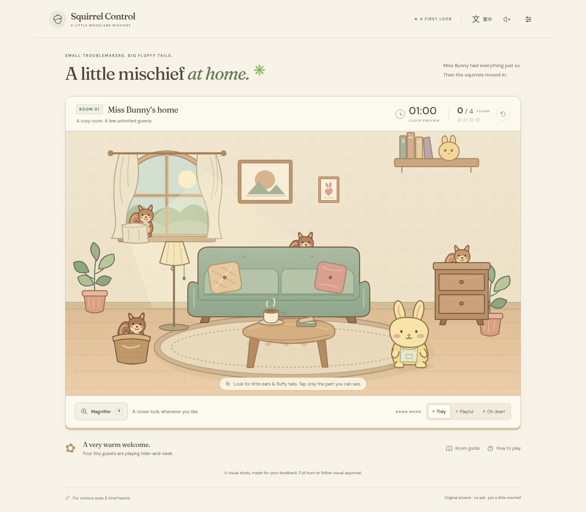

# Squirrel Control

An original, cozy illustrated hidden-character game for desktop and mobile web. This build is the **Gate A interactive visual proof of concept**, based on [GDD v1.0](docs/GDD-v1.0.md). Full production follows explicit visual acceptance.

## Review the prototype



[Phone view](docs/evidence/room-390-en-tidy.png) · [Messy room](docs/evidence/room-1440-en-messy.png) · [Touch magnifier](docs/evidence/magnifier-390.png) · [Traditional Chinese](docs/evidence/room-390-zh-TW-messy.png) · [Visual review and QA](docs/VISUAL-REVIEW.md)

The images and report can be reviewed directly on GitHub. Run the project locally to try the interactions.

## Run

Requires Node.js 22.12+ (tested: 24.19.0) and npm.

```sh
npm ci --cache /workspace/.npm
npm run dev
```

No backend, keys, accounts, or runtime network services. Illustrations are original inline layered SVG; fonts are bundled locally under their package SIL Open Font Licenses. The production build uses relative asset paths, including when hosted in a subdirectory.

```sh
npm run build
npm run preview
npm test
```

Browser tests use `/usr/bin/chromium` when installed. Otherwise install Playwright Chromium (`npx playwright install chromium`) or set `CHROMIUM_PATH` to an installed executable. The test runner builds and starts its own production preview on port 4173; do not start another process on that port before running tests.

## This visual study

- One complete layered living-room composition with original Miss Bunny and four illustrative squirrel hiding spots.
- Dedicated portrait composition below 621 CSS px; desktop composition for wider screens.
- Catch visible fur only. The full composited SVG is also the authoritative raster hit mask: solid furniture cannot catch a covered target.
- Optical 2.25× magnifier, pointer and keyboard inspection, offset touch preview, drag/tap discrimination.
- Three deliberately selectable room-mess states for visual comparison. They do not change target visibility.
- Live English / Traditional Chinese, reduced-motion and synthesized sound preferences, keyboard controls, text-clue catching alternative, restart confirmation, automatic pause when the page becomes hidden.
- Four-catch celebration and replay, for evaluating feedback and Miss Bunny's reaction.

The displayed **01:00 is a clearly labeled clock preview**. This build does not yet contain the complete ten-squirrel, randomized, timed game. It does not simulate a passed production gate. Full timing, seeded ten-target placement, time-driven deterioration, loss/retry, complete audio/animation balancing, and production acceptance belong to Gate B after visual approval. Source is provided on `main` for visual review. The game has not been deployed.

## Controls

Begin with **Let's take a peek**, then click/tap exposed squirrels. Enable the magnifier with its button or **M**. Drag on touch to inspect without catching, lift, then tap a visible squirrel. The lens preserves furniture occlusion; it never highlights or reveals targets. **Escape** dismisses the lens or dialog. With the room focused, arrow keys move inspection; **Shift + arrow** moves farther; **Enter / Space** catches at the inspected point. Tab accesses all menus. The **Room guide** supplies readable clues and explicit catch buttons for a nonvisual alternative; it intentionally makes the hunt easier.

Preference storage is optional and validated. Blocked/corrupt storage cannot prevent the scene from loading. Only language, motion, and sound settings are stored; a room study starts fresh on reload.

## Project map

- `src/room.ts`: original artwork, L0/L1/L2/L3 composition and two curated layouts.
- `src/hit-map.ts`: rendered silhouette validation and authoritative pixel hit testing.
- `src/main.ts`: input gestures, optical lens, transient room state, dialogs, feedback and preferences.
- `src/i18n.ts`: all interface and accessibility copy in both languages.
- `src/style.css`: responsive paper-and-sage interface and motion preferences.
- `tests/room.spec.ts`: production-browser interactions, touch emulation, visual evidence, visibility and accessibility checks.
- [Visual review and QA](docs/VISUAL-REVIEW.md), [hiding-spot authoring](docs/HIDING-SPOTS.md).

Engineering baseline: [UGDS v1.0.0](docs/UGDS-v1.0.0.md), pinned to `jaychtw/game-development-standards@d5c6696efdd6efc028118600466db44aecae0c9b`. Match3 Core is not used. The other match-game references are process references; no code or artwork was copied.
