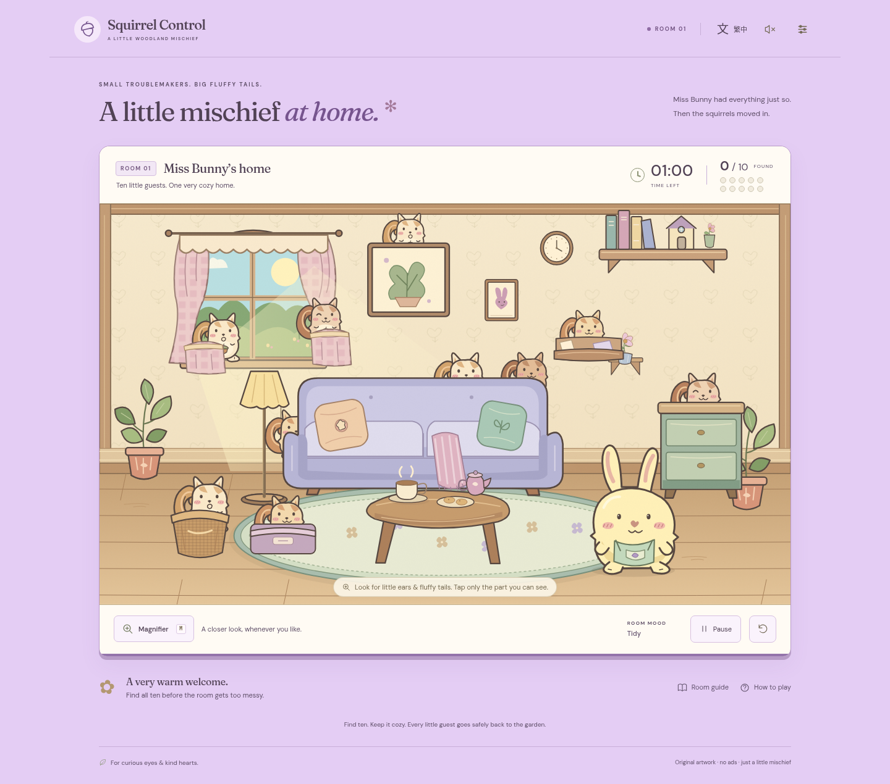

# Squirrel Control

**Room 1 — Miss Bunny’s Home · Accepted gameplay candidate, v1.0.0-rc.1**

Find ten adorable squirrels in sixty seconds while Miss Bunny’s cozy cottage slips into delightful chaos. Original layered artwork, English and Traditional Chinese, desktop and touch controls, and no backend or runtime network services.

The visual baseline at [`8e6c31e`](https://github.com/jaychtw/squirrel-control/commit/8e6c31eb81d7a8438bdfc72b001fac24d866dafc) was explicitly approved for Gate A. This implementation preserves its character designs, cottage palette, responsive composition and solid light-purple page background (`#e4cdf4`). **Hands-on playtesting passed and the owner authorized public deployment on 2026-10-25 (Asia/Taipei).** See the [publication status](docs/DEPLOYMENT.md) for the distinction between authorization, CI, deployment and live verification.

## Hands-on playtest, Round 1

[Download the playtest ZIP](playtest/squirrel-control-room1-4c1f788-playtest.zip), extract it, and follow `START-HERE.txt`. The verified route uses Python 3: run `python3 serve-playtest.py` in the extracted folder and open the computer address it prints. Windows can use `py serve-playtest.py`. Add `--lan` to test on a phone on the same Wi-Fi. No Node.js or package installation is needed to play, the helper serves only your computer or local network.

Play three fresh visual rounds, then return your device/browser, found/10 results and the most frustrating interaction. Direct HTML file opening remains unverified because this cloud browser blocks file URLs; use the helper for the verified route. [Session plan](docs/playtesting/ROUND-1.md) · [Bilingual feedback sheet](docs/playtesting/FEEDBACK.md) · [Owner playtest approval](docs/playtesting/RESULTS.md).

The package contains the unchanged `4c1f788` game candidate. `npm run test:playtest` runs the separate portable-package checks; `npm test` remains the existing game suite. The owner has accepted the hands-on playtest; no device details or session scores were reported.

## Review on GitHub



[Phone gameplay](docs/evidence/gameplay-390-en-tidy.png) · [Messy room](docs/evidence/gameplay-1440-en-messy.png) · [Success](docs/evidence/gameplay-1440-en-win.png) · [Failure](docs/evidence/gameplay-390-zh-TW-loss.png) · [Touch magnifier](docs/evidence/gameplay-magnifier-390.png) · [Gate B verification report](docs/GATE-B-REVIEW.md)

These are screenshots of the running static build. The report distinguishes controlled-clock checks, real elapsed-time validation and pending human checks. The approved Gate A character sheet and room screenshots remain in `docs/evidence` and Git history.

## Run locally

Node.js **24** and npm; `.node-version` pins the tested runtime to 24.19.0.

```sh
npm ci
npm run dev
```

In this cloud workspace the working directory is `/workspace/squirrel-control`; use `npm ci --cache /workspace/.npm` if the default home cache is not writable. No tool activation, credentials or additional services are needed.

```sh
npm run build
npm run preview
npm test
```

`build` runs strict TypeScript checks and creates `dist/` with relative asset paths. `npm test` builds and starts its own production preview on port **4173**; leave that port free. It runs core-rule tests, full rendered visibility validation, desktop/touch gameplay, localization, preferences, accessibility scans and a real 60-second countdown. Tests normally take about 90 seconds with two workers. Tests use `/usr/bin/chromium` if present; otherwise install the Playwright browser with `npx playwright install chromium` or set `CHROMIUM_PATH` to an installed Chromium executable.

## Play

Press **Start the hunt** to begin. Catch squirrels by clicking/tapping their visible ears, bodies or tails. Furniture is opaque and the counter advances only once per squirrel. All ten must be found before 60 active seconds; at exactly the deadline the result is a loss.

- **Magnifier / M:** unlimited optical inspection at 2.25×, with no added time/score penalty, cooldown or automatic target highlighting. Time continues normally. On touch, drag to inspect; lift and tap a visible squirrel to catch it. A drag cannot capture.
- **Keyboard:** Tab to the room. Arrows move inspection, Shift + arrows move farther, Enter/Space catches at its center, Escape dismisses the lens, and P pauses. Menus, restart and outcomes are keyboard accessible.
- **Pause:** explicit pause, instructions, settings and restart confirmation stop time, mess and scene interaction. Backgrounding the tab automatically pauses; returning does not resume until you choose to continue.
- **Room guide:** an easier timed nonvisual alternative, with descriptive clues and catch buttons. Its clock continues while the guide is open; it has its own pause control. The visual hunt and text hunt share the same targets, timer and outcomes.
- **Replay:** starts a fresh seeded selection of ten out of thirteen authored hides. Restarting an active round, even before any captures, requires confirmation.
- **Comfort settings:** live language switching, reduced motion, optional synthesized sound, larger text, and the room code. Only preferences are saved locally; a short round starts fresh on page reload. Blocked/corrupt storage is supported.

## Reproduce a round

Use `?seed=review-room-01` on the app URL to reproduce the documented round. Seeds accept 1–48 ASCII letters, digits, `_` or `-`; invalid seeds are ignored. The same seed selects the same guests and fur variants across desktop/portrait layouts. Copy the code from comfort settings for a bug report. Replay generates a new code; it does not change the URL or force repeats from a previous query parameter.

## Engineering

- `src/game.ts`: authoritative phases, monotonic active-time clock, capture rules and exclusive deadline outcomes.
- `src/placements.ts`: authored two-layout pool and deterministic seeded selection.
- `src/room.ts`: approved original artwork, foreground hide geometry, safe mess sublayer and host reactions.
- `src/hit-map.ts`: composited pixel hit masks, actual-silhouette ratios, crop/overlap diagnostics and target-pixel invariance.
- `src/main.ts`: application lifecycle, gestures, optical lens, dialogs, timer display and feedback.
- `src/preferences.ts`, `src/i18n.ts`, `src/icons.ts`, `src/style.css`: validated persistence, bilingual copy, icons and approved theme.
- `tests/core.spec.ts`, `tests/visibility.spec.ts`, `tests/room.spec.ts`: core rules, native/CSS-resolution geometry, actual browser play and evidence.

[Hiding-spot authoring and proof](docs/HIDING-SPOTS.md) · [Gate B QA / acceptance checklist](docs/GATE-B-REVIEW.md) · [Acceptance record](docs/ACCEPTANCE.md) · [GDD v1.0](docs/GDD-v1.0.md)

The pinned engineering baseline is [UGDS v1.0.0](docs/UGDS-v1.0.0.md), `jaychtw/game-development-standards@d5c6696efdd6efc028118600466db44aecae0c9b`. Neither standard was rewritten. Match3 Core is not used. The original art is individually composited SVG; fonts are bundled locally with their SIL Open Font License notices in `public/licenses`. No external runtime assets, accounts, analytics, ads or payments.

The development-only `node scripts/render-character-study.mjs` export regenerates the approved character-study sheet on Node 24. It is not a gameplay screenshot or evidence of final acceptance.
